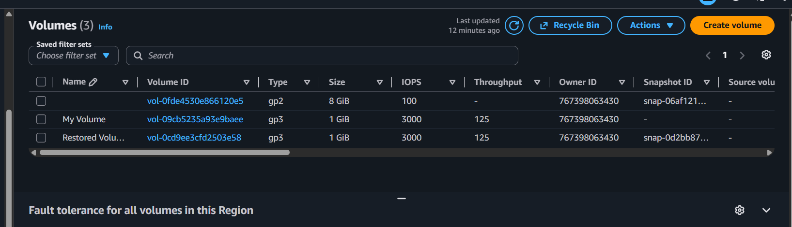
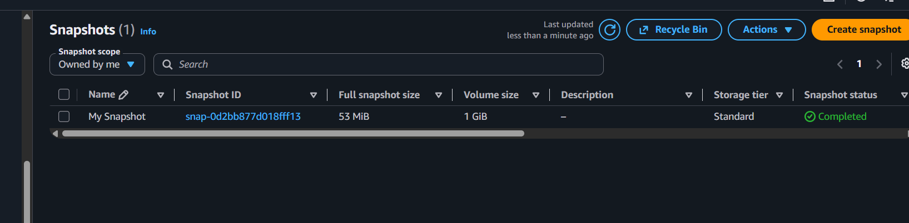

# Working with Amazon EBS

A hands-on AWS lab where I created an Amazon EBS volume, attached it to an EC2 instance, formatted and mounted it as a file system, then backed it up with a snapshot and restored the data to a new volume.

## Overview

Amazon Elastic Block Store (Amazon EBS) is a scalable, high-performance block-storage service designed for Amazon Elastic Compute Cloud (Amazon EC2). This lab walks through the full lifecycle of an EBS volume: create, attach, use, back up, and restore.

```
EC2 instance  ──(attached)──▶  EBS volume  ──(created)──▶  Snapshot (stored in S3)
```


## Technologies and Services

| Service / Tool | Purpose |
| --- | --- |
| Amazon EC2 | Compute instance (`Lab`) |
| Amazon EBS | Block storage volumes |
| EBS Snapshots | Backup and restore |
| Amazon S3 | Durable snapshot storage (managed by AWS) |
| EC2 Instance Connect | Browser-based terminal access |
| Linux CLI | File system creation, mounting, verification |

## Lab Walkthrough

### Task 1: Create a new EBS volume

1. Opened the **EC2 Management Console** and noted the Availability Zone of the `Lab` instance.
2. Went to **Elastic Block Store → Volumes** and chose **Create volume** with:
   - Volume type: **General Purpose SSD (gp2)**
   - Size: **1 GiB**
   - Availability Zone: same as the `Lab` instance
   - Tag: `Name` = `My Volume`
3. Waited for the volume state to change from *Creating* to *Available*.

### Task 2: Attach the volume to the EC2 instance

1. Selected `My Volume` → **Actions → Attach volume**.
2. Chose the `Lab` instance and set the device name to `/dev/sdb`.
3. Confirmed the volume state changed to **In-use**.

### Task 3: Connect to the instance

Connected to the `Lab` instance using **EC2 Instance Connect** from the EC2 console (**Instances → Connect → EC2 Instance Connect → Connect**).

### Task 4: Create and configure the file system

Checked available storage (the new volume does not appear yet):

```bash
df -h
```

Created an ext3 file system on the new volume:

```bash
sudo mkfs -t ext3 /dev/sdb
```

Created a mount point and mounted the volume:

```bash
sudo mkdir /mnt/data-store
sudo mount /dev/sdb /mnt/data-store
```

Made the mount persistent across reboots by adding it to `/etc/fstab`:

```bash
echo "/dev/sdb   /mnt/data-store ext3 defaults,noatime 1 2" | sudo tee -a /etc/fstab
cat /etc/fstab
```

Verified the volume now appears, then wrote a test file to it:

```bash
df -h
sudo sh -c "echo some text has been written > /mnt/data-store/file.txt"
cat /mnt/data-store/file.txt
```

### Task 5: Create an EBS snapshot

1. Selected `My Volume` → **Actions → Create snapshot**, tagged `Name` = `My Snapshot`.
2. Checked **Snapshots** until the status changed from *Pending* to *Completed*.
3. Simulated data loss by deleting the test file:

```bash
sudo rm /mnt/data-store/file.txt
ls /mnt/data-store/file.txt
# ls: cannot access /mnt/data-store/file.txt: No such file or directory
```

### Task 6: Restore the snapshot

**6.1 Create a volume from the snapshot**
Selected `My Snapshot` → **Actions → Create volume from snapshot** in the same Availability Zone, tagged `Name` = `Restored Volume`.

**6.2 Attach the restored volume**
Attached `Restored Volume` to the `Lab` instance as `/dev/sdc`.

**6.3 Mount the restored volume and verify the data**

```bash
sudo mkdir /mnt/data-store2
sudo mount /dev/sdc /mnt/data-store2
ls /mnt/data-store2/file.txt
```

The deleted `file.txt` was present on the restored volume, confirming the snapshot backup and restore worked.

## Key Takeaways

- EBS volumes are tied to a single Availability Zone and must match the instance's AZ to attach.
- A new volume has no file system; it must be formatted and mounted before use.
- Entries in `/etc/fstab` keep a volume mounted after the instance restarts.
- Snapshots are an efficient way to back up, clone, or restore data, and can also be shared across AWS accounts or copied across Regions.
- A restored volume can be given a different type, size, or Availability Zone from the original.

## Screenshots

<!-- Add your screenshots to a /screenshots folder and update the paths below -->

## Screenshots

### Volume created


### Snapshot completed

